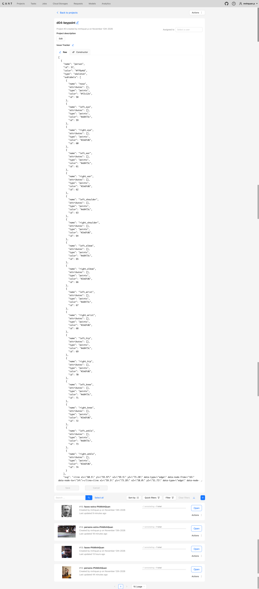
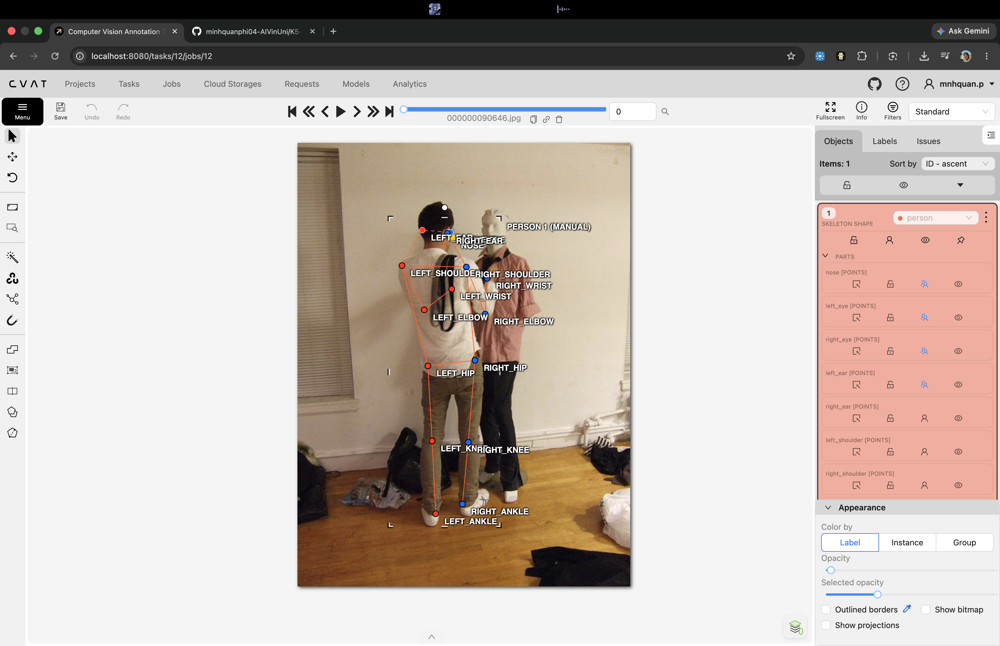
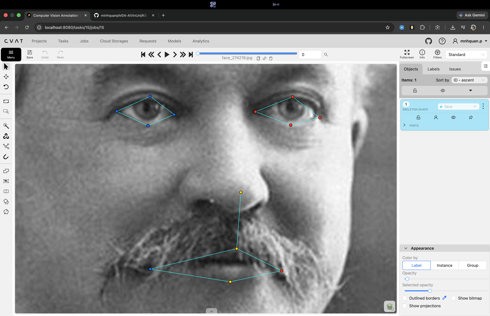
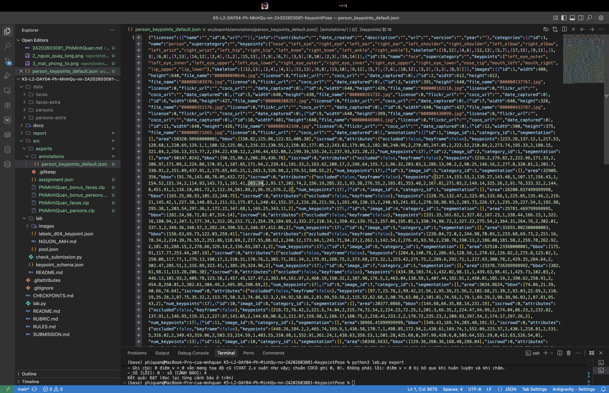

# Báo cáo cá nhân — Phí Minh Quân - 2A202603081

Dữ liệu: 12 ảnh người COCO val2017 (Lin et al., 2014) và 8 ảnh chân dung Wikimedia Commons, chỉ dùng trong lớp.

## 0. Thông tin học viên

- Họ tên: Phí Minh Quân
- MSSV: 2A202603081
- Email: minhquanphi04@gmail.com 
- Link repository: https://github.com/minhquanphi04-AIVinUni/K5-L2-DAY04-Ph-MinhQu-nn-2A202603081-KeypointPose.git
- Phiên bản CVAT (Help → About): 2.74.1
- Máy: hệ điều hành macOS · RAM 16 GB · chạy CVAT chế độ đầy đủ
- Bộ ảnh (`src/exports/assignment.json` do `lab.py setup` tạo): có
Hai task chính: 12/11
- Giờ bắt đầu: 18:00
- Giờ kết thúc: 19:00
Task bonus: 13/11
- Giờ bắt đầu: 07:00
- Giờ kết thúc: 07:23
## 1. Kiểm tra label (CP0)

| Label | Kiểu | Số điểm | Tên điểm đúng bảng của lab? | Đúng thứ tự? | Số cạnh |
|---|---|---:|---|---|---:|
| `person` | Skeleton | 17 | Có | Có | 19 |
| `face` | Skeleton | 13 | Có | Có | 13 |

Mẫu `person` dựng theo người quay mặt về camera (các điểm `left_*` nằm bên phải khung mẫu)? Có

Cách đổi cờ `occluded` / `outside` cho **một điểm** trên phiên bản CVAT này (một câu):

-> Rê chuột vào điểm cần đổi (hoặc chuột phải vào điểm), bấm phím `Q` để đổi thành `occluded` (v = 1), bấm phím `O` để đổi thành `outside` (v = 0).

## 2. Số lượng đã gán và thời gian (CP1, CP2)

| Nhóm ảnh | Số ảnh | Số skeleton đã gán | Số người dưới 60 px (không gán) | Số poster / gương / màn hình bỏ qua | Thời gian (phút) |
|---|---:|---:|---:|---:|---:|
| `easy` | 5 | 5 | 0 | 0 | 15' |
| `occluded` | 3 | 5 | 0 | 0 | 15' |
| `back` | 2 | 4 | 0 | 0 | 15' |
| `small` | 1 | 1 | 0 | 0 | 2' |
| `crowd` | 1 | 3 | 0 | 0 | 5' |
| `faces` | 8 | 8 | — | 0 | 8' |

- Số ảnh người đã xong ở mốc phút 105: 10 / 10
- Thời gian thực tế (phút): CP1 15' · CP2 15' · CP3 10'
- Ảnh tốn thời gian nhất là ảnh nào, vì sao?

-> Ảnh 000000542160.jpg của person tốn thời gian nhất. Vì có 3 người cần gán trong đám đông, các đối tượng đứng chen chúc, che khuất nhau và phải kiểm tra lại 1-2 lần để không bị lỗi tráo trái/phải (`lr_swap`). 

## 3. Bảng ca khó (CP1, CP2)

Mỗi điểm bạn phân vân một dòng, nhất là phân vân giữa `v = 1` và `v = 0`, hoặc không chắc hướng người.

| Ảnh | Người / mặt | Điểm | Cờ đã chọn | Phân vân giữa | Lý do chọn |
|---|---|---|---:|---|---|
| `000000438099.jpg` | Người 1 (nhỏ/xa) | Cổ chân trái/phải | `outside` (0) | `v = 1` và `v = 0` | Người ở xa, phần cẳng chân dưới bị vật cản che khuất hoàn toàn, không thể ước lượng chắc chắn vị trí mắt cá |
| `000000571665.jpg` | Người 1 (trượt tuyết) | Đầu gối/cổ chân | `outside` (0) | `v = 1` và `v = 0` | Bụi tuyết bắn lên che khuất hoàn toàn chân, chọn `v = 0` để tránh đoán bừa |
| `face_324513.jpg` | Mặt 1 | Các điểm quanh 2 mắt | `occluded` (1) | `v = 1` và `v = 0` | Đeo kính râm tối màu che mắt, nhưng dựa vào gọng kính vẫn ước lượng chắc chắn được vị trí giải phẫu của mắt |

## 4. Bảng tự review (CP3)

Đi từ ảnh cuối về ảnh đầu. 5 ảnh người (ít nhất 2 ảnh `back` hoặc `crowd`) và 3 ảnh mặt. Ít nhất 8 dòng, kể cả dòng `ok`. Ghi lỗi trước, sửa sau.

Mã lỗi dùng đúng một trong: `lr_swap`, `vis_flag`, `position`, `missing`, `extra`, `ok`.

| Ảnh | Người / mặt | Điểm | Mã lỗi | Ghi chú | Đã sửa? |
|---|---|---|---|---|---|
| `000000571665.jpg` | Người 1 | Khớp hông | `ok` | Tư thế vặn người khi trượt tuyết, khớp hông xoay nghiêng đúng giải phẫu | Có (đã kiểm tra) |
| `000000542160.jpg` | Người 2 | Khớp gối, cổ chân | `ok` | Tư thế bước vắt chéo chân trong đám đông, các điểm gán đúng chân | Có (đã kiểm tra) |
| `000000351176.jpg` | Người 1, 2 | Toàn thân (back) | `ok` | Người quay lưng, đã tráo đúng toàn bộ điểm `left_*` sang bên trái ảnh | Có (đã kiểm tra) |
| `000000308257.jpg` | Người 1 | Cổ chân | `ok` | Người ngồi vắt chéo chân, cổ chân bắt chéo tự nhiên | Có (đã kiểm tra) |
| `000000163118.jpg` | Người 2 | Cổ tay (wrist) | `ok` | Người quay lưng vắt tay qua thân, đã kiểm tra đúng tay trái/phải | Có (đã kiểm tra) |
| `face_324513.jpg` | Mặt 1 | Vùng mắt (kính râm) | `ok` | 8 điểm quanh 2 mắt sau tròng kính râm đặt cờ `v = 1` (occluded) chuẩn xác | Có (đã kiểm tra) |
| `face_476363.jpg` | Mặt 1 | Mắt xa camera | `ok` | Mặt nghiêng, mí mắt và khóe mắt đặt bám sát mép giải phẫu | Có (đã kiểm tra) |
| `face_92028.jpg` | Mặt 1 | Toàn bộ 13 điểm | `ok` | Mặt thẳng, tỉ số mở mắt và khóe miệng đặt chuẩn xác | Có (đã kiểm tra) |

Tổng hợp số lỗi theo mã:

| `lr_swap` | `vis_flag` | `position` | `missing` | `extra` | `ok` |
|---:|---:|---:|---:|---:|---:|
| 0 | 0 | 0 | 0 | 0 | 8 |

Điểm còn phân vân giữa `v = 1` và `v = 0` (ghi cả hai lựa chọn và lý do chọn):

- Các điểm chân bị tuyết che trong ảnh `000000571665.jpg` và người ở xa trong `000000438099.jpg`: Phân vân giữa `v = 1` (ước lượng ngoại suy theo trục xương) và `v = 0` (bị che hoàn toàn không thể xác định chính xác). Đã chọn `v = 0` theo đúng nguyên tắc cốt lõi của lab: "Không đoán bừa, điểm ngoài ảnh hoặc không đoán chắc chắn thì để outside".

## 5. Kiểm file xuất và kết quả tự kiểm (CP4)

Tự kiểm tay trong file JSON:

| File | Người / mặt kiểm (ảnh, thứ tự) | Số phần tử `keypoints` | Điểm `outside` ra `v = 0`, `occluded` ra `v = 1`? | `num_keypoints` khớp? |
|---|---|---:|---|---|
| `PhiMinhQuan_persons.zip` | `000000438099.jpg`, người 1 (id: 11) | 51 | Đúng (có 4 điểm `v = 0`, 7 điểm `v = 1`) | Khớp (13/17 điểm `v > 0`) |
| `PhiMinhQuan_persons.zip` | `000000103970.jpg`, người 1 (id: 2) | 51 | Đúng (có 1 điểm `v = 1`, 16 điểm `v = 2`) | Khớp (17/17 điểm `v > 0`) |
| `PhiMinhQuan_faces.zip` | `face_324513.jpg`, mặt 1 (id: 5, kính râm) | 39 | Đúng (có 8 điểm `v = 1` sau tròng kính râm) | Khớp (13/13 điểm `v > 0`) |

Sau khi xuất, CVAT ghi `occluded` thành `v = 1` và `outside` thành `v = 0`. Tọa độ của điểm `outside` trong file là `0, 0` hay tọa độ cũ? **tọa độ cũ** (CVAT 2.x xuất như vậy, chuẩn COCO gốc ghi 0, 0; các điểm `v = 0` đều được model bỏ qua khi tính loss).

Hai job đã chuyển sang completed trên CVAT? Có 

Dán phần **TÓM TẮT** in ra từ `src/check_submission.py`:

```text
----- TÓM TẮT -----
- File person: PhiMinhQuan_persons.zip
  Số ảnh: 12 · số skeleton `person`: 18 · mỗi annotation 51 số
  Skeleton theo ảnh: 000000090646=1, 000000103970=1, 000000137767=1, 000000163118=2, 000000261732=1, 000000308257=1, 000000351176=2, 000000433787=1, 000000438099=1, 000000469061=2, 000000542160=3, 000000571665=2
  Cờ v: v=2 225 (74%) · v=1 73 (24%) · v=0 8 (3%)
  num_keypoints trung bình: 16.6
- File face: PhiMinhQuan_faces.zip
  Số ảnh: 8 · số skeleton `face`: 8 · mỗi annotation 39 số
  Skeleton theo ảnh: face_145621=1, face_145751=1, face_204787=1, face_288853=1, face_324513=1, face_38721=1, face_476363=1, face_92028=1
  Cờ v: v=2 93 (89%) · v=1 11 (11%) · v=0 0 (0%)
  num_keypoints trung bình: 13.0
- Ghi chú: 8 điểm v = 0 vẫn mang tọa độ cũ (CVAT 2.x xuất như vậy; chuẩn COCO ghi 0, 0). Không phải lỗi: điểm v = 0 bị bỏ qua khi huấn luyện và khi chấm.
- Số [LỖI]: 0 · số [CẢNH BÁO]: 4
Kết quả: ĐẠT (đọc lại từng cảnh báo ở trên)
```

Các `[CẢNH BÁO]` còn giữ nguyên và lý do:

- `000000163118.jpg #2` (cặp wrist): Người đứng quay lưng và đan chéo tay qua thân người, nên tọa độ x của cổ tay đảo chiều so với vai nhưng nhãn gán đúng theo giải phẫu thật.
- `000000308257.jpg #1` (cặp ankle): Người ngồi vắt chéo chân tự nhiên, cổ chân trái bắt qua phía bên phải và ngược lại.
- `000000542160.jpg #2` (cặp knee, ankle): Tư thế bước đi / vắt chéo chân trong đám đông khiến khớp gối và cổ chân đảo phía so với thân trên.
- `000000571665.jpg #1` (cặp hip): Người đang chuyển động nghiêng mạnh về một bên khi vận động, góc chụp làm khớp hông vặn xoay so với góc nhìn camera.
## 6. Ảnh chụp màn hình

1. Label `person` trong label constructor (đủ 17 điểm có tên):

   

2. Một người quay lưng đã gán, cờ đã đặt:

   

3. Một khuôn mặt đã gán 13 điểm, phóng to vùng mắt:

   

4. Một đoạn JSON xuất của một người:

   

Nguồn ảnh: COCO val2017 / Wikimedia Commons.

## 7. Tự đánh giá

1. Lỗi bạn mắc nhiều nhất hôm nay, và cách bạn sẽ tránh ở dự án thật:

   - Không có

2. Một quy tắc bạn đề xuất thêm vào guideline (kèm ảnh ví dụ nếu có):

   - Không có

3. Nhãn của bạn đi vào model ở đâu? Chọn một lỗi bạn đã sửa và nói nó sẽ làm model học sai thế nào (heatmap, trọng số trong loss, hay bước lật ảnh):

   ...

## 8. Khó khăn và lỗi kỹ thuật

...

## Bonus (nếu làm)

### B1 — 3 ảnh người khó thêm

| Ảnh | Số skeleton | Số người dưới 60 px | Ca khó nhất |
|---|---:|---:|---|
| `000000065350.jpg` | 3 | 0 | Đám đông nhiều người, người số 3 có chân vắt chéo tự nhiên |
| `000000254060.jpg` | 2 | 0 | Người vận động mạnh, nhiều khớp khuỷu/gối bị che khuất |
| `000000517702.jpg` | 2 | 0 | Góc chụp nghiêng phức tạp, thân người chồng lên nhau |

Kết quả `src/check_submission.py` cho `HoVaTen_bonus_persons.zip`:

```----- TÓM TẮT -----
- File person: PhiMinhQuan_bonus_persons.zip
  Số ảnh: 3 · số skeleton `person`: 7 · mỗi annotation 51 số
  Skeleton theo ảnh: 000000065350=3, 000000254060=2, 000000517702=2
  Cờ v: v=2 75 (63%) · v=1 44 (37%) · v=0 0 (0%)
  num_keypoints trung bình: 17.0
- Số [LỖI]: 0 · số [CẢNH BÁO]: 2
Kết quả: ĐẠT (đọc lại từng cảnh báo ở trên)
```

### B2 — 5 ảnh khuôn mặt đen trắng / hồng ngoại

Ảnh không màu khó hơn ở điểm nào? Kính râm trên ảnh hồng ngoại có còn là `v = 1` không?

- Ảnh không màu không khó hơn, thậm chí còn dễ và nhanh hơn vì mắt đỡ phải xử lí nhiều thông tin
- Có? Vì trên ảnh hồng ngoại kính râm sẽ hẫm thụ nhiều ảnh sáng, nhiệt, nên sẽ là vùng sáng nhất -> Không rõ mắt

### B3 — Model so với nhãn của tôi (không tính điểm)
-> Em không làm phần này
- Demo đã dùng:
- Ảnh đã thử:

1. Model có trả điểm cho khớp bị che, hay khớp ngoài ảnh không? Confidence ở các điểm đó thế nào?

   ...

2. Với người quay lưng, model có đổi trái/phải không?

   ...

3. Bộ điểm của model có giống 17 điểm COCO không?

   ...

## 9. Tài liệu tham khảo và công cụ AI đã dùng

- Hướng dẫn thực hành Lab Ngày 4 (`docs/GUIDELINE.md`, `docs/CVAT_CHEATSHEET.md`, `docs/COCO_KEYPOINTS.md`).
- Chuẩn COCO Keypoints 1.0 (Lin et al., 2014) và CVAT 2.74.1 Documentation.
- Antigravity AI Assistant: Hỗ trợ rà soát, kiểm tra script `check_submission.py` và đối chiếu định dạng file nộp.
